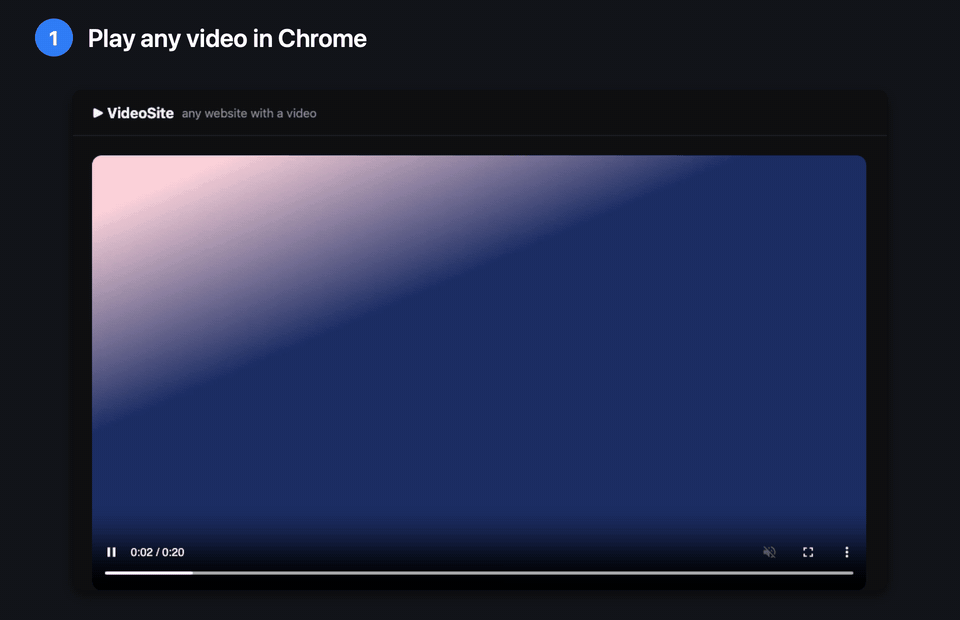
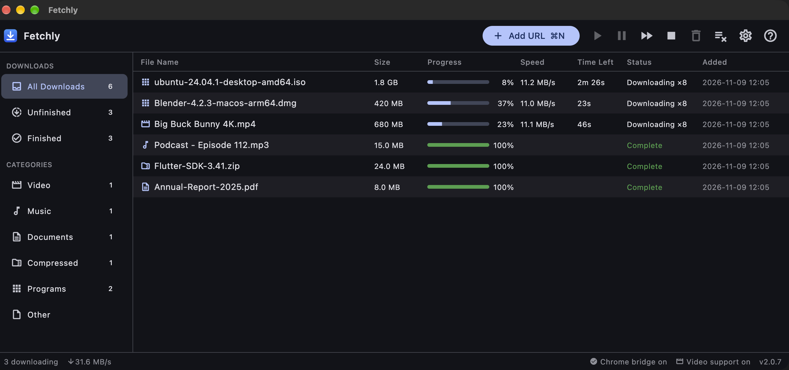
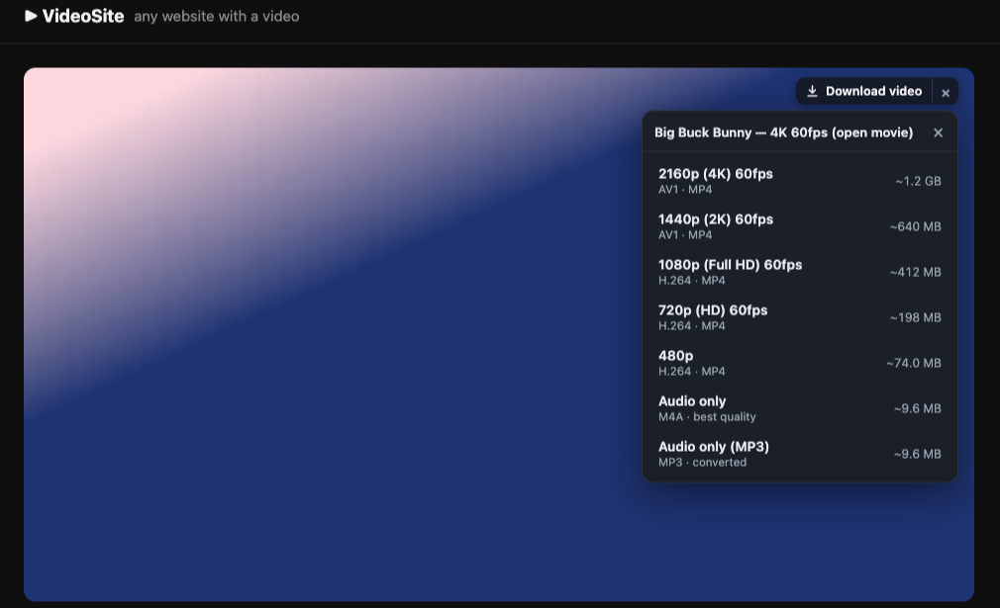
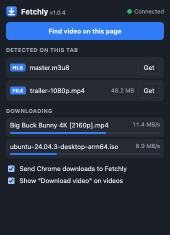
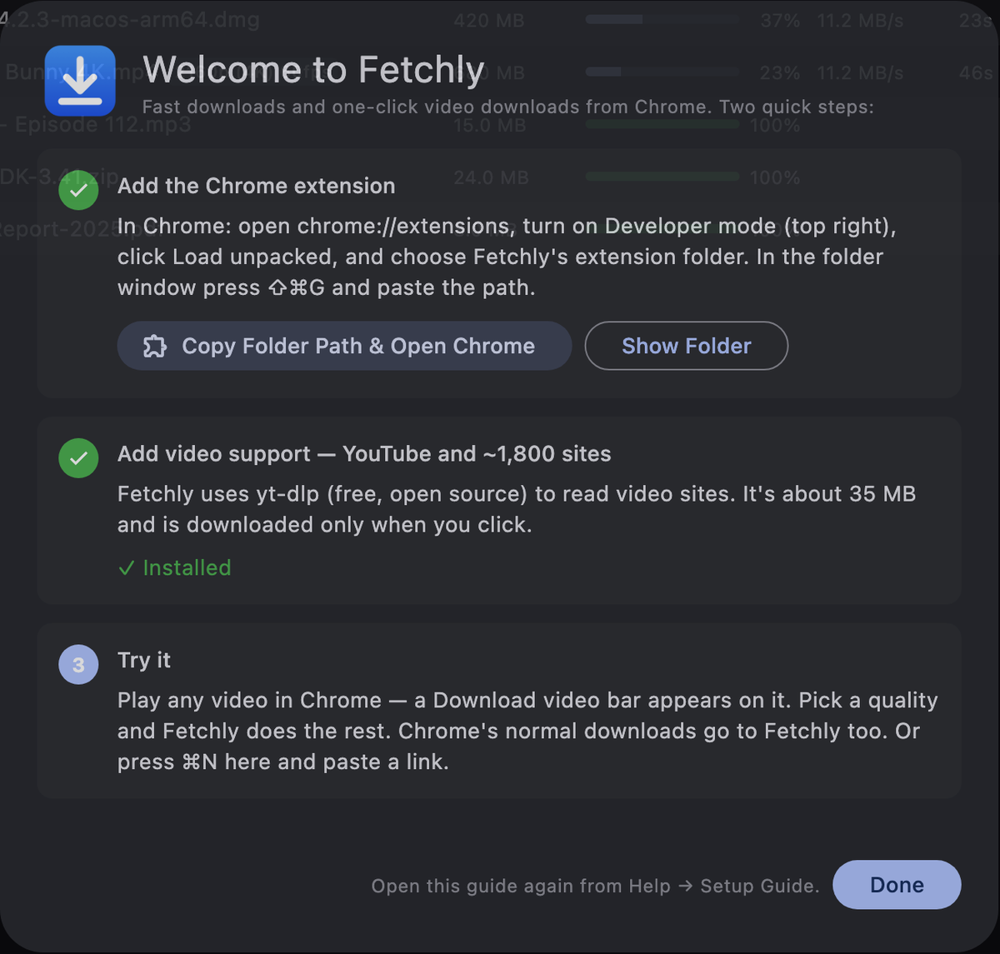
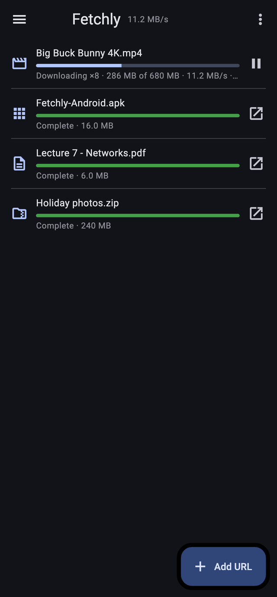

  

<h1 align="center">Fetchly</h1>

  <b>A fast download manager for Mac, Windows, Linux and Android, with one-click video downloads from Chrome.</b> 
  Multi-connection downloads · resume after anything · YouTube up to 4K · free

  <a href="https://muksiturrahman.github.io/fetchly/"><b>⬇ Download Fetchly</b></a> (picks your system)
   
  <a href="https://github.com/muksiturrahman/fetchly/releases/latest/download/Fetchly.dmg"><b>Mac</b></a>
  &nbsp;·&nbsp;
  <a href="https://github.com/muksiturrahman/fetchly/releases/latest/download/Fetchly-Windows.zip"><b>Windows</b></a>
  &nbsp;·&nbsp;
  <a href="https://github.com/muksiturrahman/fetchly/releases/latest/download/Fetchly-Linux.tar.gz"><b>Linux</b></a>
  &nbsp;·&nbsp;
  <a href="https://github.com/muksiturrahman/fetchly/releases/latest/download/Fetchly-Android.apk"><b>Android</b></a>
   
  <a href="docs/INSTALL.md">Install guides</a>
  &nbsp;·&nbsp;
  <a href="docs/HOW-IT-WORKS.md">How it works</a>
  &nbsp;·&nbsp;
  <a href="CHANGELOG.md">What's new</a>

  
  
  
  
  
  
  
  

  

## Why Fetchly

Downloading is either slow (one connection, no resume) or fiddly (copy a link into a terminal tool). Fetchly brings the experience of **Internet Download Manager** to every computer, and to Android:

- 🚀 **Faster downloads:** every file downloads in parallel parts over up to 32 connections. When a part finishes early, its connection takes over half of the slowest part, so no connection sits idle.
- ⏯️ **Resume after anything:** pause, lose Wi-Fi, quit or even crash. Fetchly continues each part exactly where it stopped.
- 🎬 **One-click video downloads:** play a video in Chrome and a **Download video** bar appears on it by itself. Pick **4K, 1440p, 1080p … audio only or MP3**. Works with YouTube and about 1,800 other sites.
- 🧲 **Takes over Chrome's downloads,** with your cookies, so files behind a login work too.
- 📱 **On Android too:** paste a link or **Share → Fetchly** from any app. Files go to **Download/Fetchly**.
- 🔒 **Private:** everything stays on your device. The browser bridge listens on `127.0.0.1` only and refuses web pages. No history is kept.
- 🪶 **Light:** about 20 MB, nothing running in the background when idle; each download runs on its own thread, so the window stays smooth at any speed.

| Quality picker on any video | Extension popup | First-launch setup guide | Android |
| --- | --- | --- | --- |
|  |  |  |  |

## Download

| File | For |
| --- | --- |
| **[Fetchly.dmg](https://github.com/muksiturrahman/fetchly/releases/latest/download/Fetchly.dmg)** | **Mac** (macOS 12+, Apple Silicon and Intel). Open it and drag Fetchly to Applications. [Fetchly.zip](https://github.com/muksiturrahman/fetchly/releases/latest/download/Fetchly.zip) is the same app as a zip |
| **[Fetchly-Windows.zip](https://github.com/muksiturrahman/fetchly/releases/latest/download/Fetchly-Windows.zip)** | **Windows** 10 and 11 (64-bit). Unzip anywhere and run `fetchly.exe` |
| **[Fetchly-Linux.tar.gz](https://github.com/muksiturrahman/fetchly/releases/latest/download/Fetchly-Linux.tar.gz)** | **Linux** (64-bit, GTK 3). Extract and run `fetchly` |
| **[Fetchly-Android.apk](https://github.com/muksiturrahman/fetchly/releases/latest/download/Fetchly-Android.apk)** | **Android** 7+ phones (64-bit, almost all phones). Older 32-bit phones: [Fetchly-Android-armv7.apk](https://github.com/muksiturrahman/fetchly/releases/latest/download/Fetchly-Android-armv7.apk) |
| [Fetchly-Chrome-Extension.zip](https://github.com/muksiturrahman/fetchly/releases/latest/download/Fetchly-Chrome-Extension.zip) | The Chrome extension on its own. You don't need it: the computer apps already include it and keep it updated |

Older versions and release notes are on the [Releases page](https://github.com/muksiturrahman/fetchly/releases).

## Install

**[Open the download page →](https://muksiturrahman.github.io/fetchly/)** It detects your system and shows the right file and steps.

| System | Download | Step-by-step guide |
| --- | --- | --- |
| **Mac** · macOS 12+, Apple Silicon and Intel | [Fetchly.dmg](https://github.com/muksiturrahman/fetchly/releases/latest/download/Fetchly.dmg) | [Install on a Mac](docs/install/mac.md) |
| **Windows** · 10 and 11, 64-bit | [Fetchly-Windows.zip](https://github.com/muksiturrahman/fetchly/releases/latest/download/Fetchly-Windows.zip) | [Install on Windows](docs/install/windows.md) |
| **Linux** · 64-bit, GTK 3 | [Fetchly-Linux.tar.gz](https://github.com/muksiturrahman/fetchly/releases/latest/download/Fetchly-Linux.tar.gz) | [Install on Linux](docs/install/linux.md) |
| **Android** · 7+ | [Fetchly-Android.apk](https://github.com/muksiturrahman/fetchly/releases/latest/download/Fetchly-Android.apk) | [Install on Android](docs/install/android.md) |

On a computer it's three steps: install the app, add the Chrome extension (the app's setup guide walks you through it), and click **Download yt-dlp** for YouTube and other video sites.

## Using it

| To… | Do this |
| --- | --- |
| Download a video in Chrome | Play it, click **Download video** on it, then pick a quality |
| Download a file | Click the link in Chrome as usual, and Fetchly takes it over |
| Paste a link | **⌘N** on a Mac, **Ctrl+N** on Windows and Linux (**⇧** adds the clipboard). On Android: **Add URL** or **Share → Fetchly**. Video pages open the quality list |
| Pause, resume or retry | Use the toolbar or right-click a download |
| See each connection | Double-click an unfinished download to open its properties and the segment bar |
| Forget the list | **Clear History…** in the File menu (Mac), the ⋮ menu (Android) or Settings → Privacy (files stay on disk) |

🛠️ Curious about what happens under the hood? **[How it works](docs/HOW-IT-WORKS.md)** covers dynamic segmentation, crash-safe resume, how the quality list is built, how the bar finds the main video without blinking, and the security model.

## FAQ

**Is Fetchly free?** Yes, free to download and use. See the [license](LICENSE).

**Can it download Netflix / Disney+ / Spotify?** No. DRM-protected streams are encrypted and can't be saved by any download manager.

**Why won't a 4K `.mp4` play in QuickTime?** YouTube's 4K is AV1 or VP9. QuickTime plays AV1 only on newer Macs and never plays VP9. Use [IINA](https://iina.io) or VLC, or switch to **MKV** in **Settings → Video**.

**Why isn't the extension in the Chrome Web Store?** Google doesn't allow YouTube downloaders there, so it's loaded in developer mode. That takes about 30 seconds.

**Why does macOS (or Windows SmartScreen) ask me to confirm the first launch?** The app isn't signed with a paid Apple or Microsoft certificate yet. Fetchly runs only on your device, sends nothing anywhere except to the sites you download from — and, once a day, a question to GitHub whether a newer Fetchly exists (only your IP address and the app version; you can turn it off in Settings), and downloads yt-dlp only when you click.

**Does YouTube work on Android?** Yes, up to 1080p with sound: paste or share a YouTube link and pick a quality. For some videos (often kids' videos) YouTube allows phone apps only 360p; Fetchly then offers just that. 4K and the other ~1,800 video sites need the computer app (they use yt-dlp). On other sites, the Android app finds the videos on the page and lists them by quality and size.

**iPhone?** iOS only installs apps from the App Store, which doesn't allow video downloaders, so there's no iPhone version.

## Feedback

Found a bug or have an idea? [Open an issue](https://github.com/muksiturrahman/fetchly/issues). Please include your system (macOS, Windows, Linux or Android and its version), Fetchly's version (bottom right of the window) and the link that didn't work.

## Use responsibly

Only download content you have the right to download, and respect each site's terms of service and copyright law.

## License

Free to use. See [LICENSE](LICENSE). © 2026 Muksitur Rahman. yt-dlp and ffmpeg are separate projects under their own licenses. Fetchly doesn't include them.
