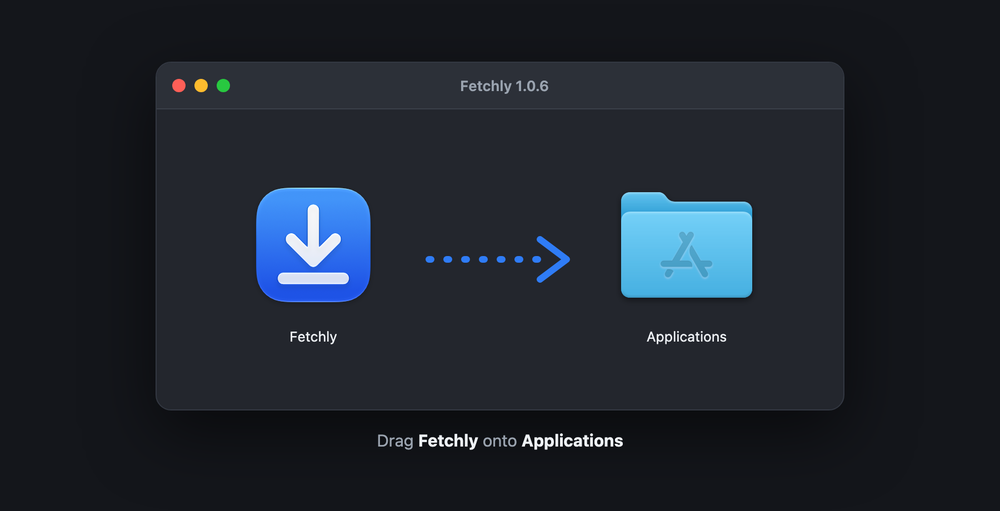
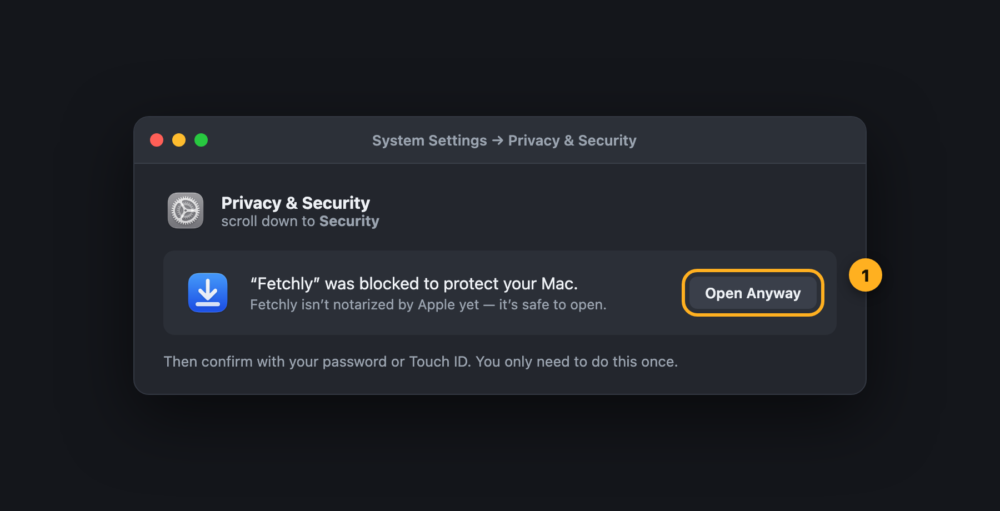
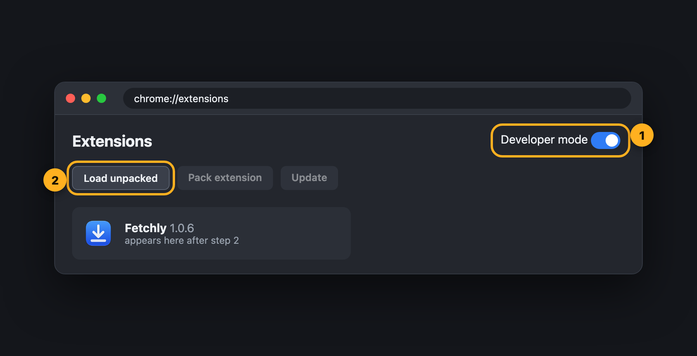

  

<h1 align="center">Fetchly</h1>

  <b>A fast download manager for macOS, with one-click video downloads from Chrome.</b> 
  Multi-connection downloads · resume after anything · YouTube up to 4K · free

  <a href="https://github.com/muksiturrahman/fetchly/releases/latest/download/Fetchly.dmg"><b>⬇ Download for Mac</b></a>
  &nbsp;·&nbsp;
  <a href="docs/INSTALL.md">Install guide</a>
  &nbsp;·&nbsp;
  <a href="docs/HOW-IT-WORKS.md">How it works</a>
  &nbsp;·&nbsp;
  <a href="CHANGELOG.md">What's new</a>

  
  
  
  
  
  

  

## Why Fetchly

Downloading on a Mac is either slow (one connection, no resume) or fiddly (copy a link into a terminal tool). Fetchly brings the experience of **Internet Download Manager** to macOS, built as a native SwiftUI app:

- 🚀 **Faster downloads:** every file downloads in parallel parts over up to 32 connections. When a part finishes early, its connection takes over half of the slowest part, so no connection sits idle.
- ⏯️ **Resume after anything:** pause, lose Wi-Fi, quit or even crash. Fetchly continues each part exactly where it stopped.
- 🎬 **One-click video downloads:** play a video in Chrome and a **Download video** bar appears on it by itself. Pick **4K, 1440p, 1080p … audio only or MP3**. Works with YouTube and about 1,800 other sites.
- 🧲 **Takes over Chrome's downloads,** with your cookies, so files behind a login work too.
- 🔒 **Private:** everything stays on your Mac. The browser bridge listens on `127.0.0.1` only and refuses web pages. No history is kept.
- 🪶 **Small and native:** a 2 MB download for Apple Silicon and Intel.

| Quality picker on any video | Extension popup | First-launch setup guide |
| --- | --- | --- |
|  |  |  |

## Download

| File | What it is |
| --- | --- |
| **[Fetchly.dmg](https://github.com/muksiturrahman/fetchly/releases/latest/download/Fetchly.dmg)** | The app. Open it and drag Fetchly to Applications **(recommended)** |
| [Fetchly.zip](https://github.com/muksiturrahman/fetchly/releases/latest/download/Fetchly.zip) | The same app as a zip |
| [Fetchly-Chrome-Extension.zip](https://github.com/muksiturrahman/fetchly/releases/latest/download/Fetchly-Chrome-Extension.zip) | The Chrome extension on its own. You don't need it: the app already includes the extension and keeps it updated |

Older versions and release notes are on the [Releases page](https://github.com/muksiturrahman/fetchly/releases).

## Install in 3 minutes

| | Step | |
| --- | --- | --- |
| **1** | Download **[Fetchly.dmg](https://github.com/muksiturrahman/fetchly/releases/latest/download/Fetchly.dmg)**, open it and drag Fetchly to **Applications** |  |
| **2** | Open Fetchly. On first launch, go to **System Settings → Privacy & Security → Open Anyway** (the app isn't notarized by Apple yet) |  |
| **3** | In the setup guide that opens, click **Copy Folder Path & Open Chrome**. In Chrome turn on **Developer mode**, click **Load unpacked**, then press **⇧⌘G**, paste and click **Select** |  |
| **4** | Click **Download yt-dlp** (35 MB) for YouTube and other video sites. For 1080p+ and 4K, also run `brew install ffmpeg` |  |

📖 **[The full install guide](docs/INSTALL.md)** has a picture for every step, plus updating, uninstalling and troubleshooting.

## Using it

| To… | Do this |
| --- | --- |
| Download a video in Chrome | Play it, click **Download video** on it, then pick a quality |
| Download a file | Click the link in Chrome as usual, and Fetchly takes it over |
| Paste a link | **⌘N** (or **⇧⌘V** to use the clipboard). Video pages open the quality list |
| Pause, resume or retry | Use the toolbar or right-click a download |
| See each connection | Double-click an unfinished download to open its properties and the segment bar |
| Forget the list | **File → Clear History…** (files stay on disk) |

🛠️ Curious about what happens under the hood? **[How it works](docs/HOW-IT-WORKS.md)** covers dynamic segmentation, crash-safe resume, how the quality list is built, how the bar finds the main video without blinking, and the security model.

## FAQ

**Is Fetchly free?** Yes, free to download and use. See the [license](LICENSE).

**Can it download Netflix / Disney+ / Spotify?** No. DRM-protected streams are encrypted and can't be saved by any download manager.

**Why won't a 4K `.mp4` play in QuickTime?** YouTube's 4K is AV1 or VP9. QuickTime plays AV1 only on newer Macs and never plays VP9. Use [IINA](https://iina.io) or VLC, or switch to **MKV** in **Settings → Video**.

**Why isn't the extension in the Chrome Web Store?** Google doesn't allow YouTube downloaders there, so it's loaded in developer mode. That takes about 30 seconds.

**Why does macOS ask me to confirm the first launch?** The app isn't notarized by Apple yet. Fetchly runs only on your Mac, sends nothing anywhere except to the sites you download from, and downloads yt-dlp only when you click.

**Windows or Linux?** Not yet. Fetchly is a native macOS app.

## Feedback

Found a bug or have an idea? [Open an issue](https://github.com/muksiturrahman/fetchly/issues). Please include your macOS version, Fetchly's version (bottom right of the window) and the link that didn't work.

## Use responsibly

Only download content you have the right to download, and respect each site's terms of service and copyright law.

## License

Free to use. See [LICENSE](LICENSE). © 2026 Muksitur Rahman. yt-dlp and ffmpeg are separate projects under their own licenses. Fetchly doesn't include them.
