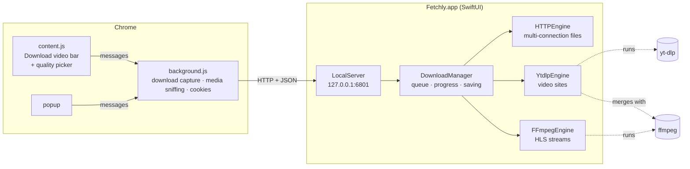
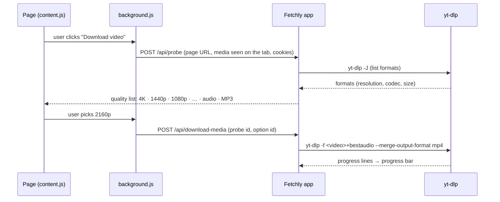

# How Fetchly works

Fetchly is two small programs that talk to each other on your Mac:

- a native **SwiftUI app**, which does the downloading;
- a **Chrome extension** (Manifest V3), which watches the browser.

The app drives two well-known command-line tools when it needs them: **yt-dlp** for video sites and **ffmpeg** for joining streams.



---

## 1 · Multi-connection downloads

A server sends a file faster when it's asked for several pieces at once, so Fetchly splits each file into **parts** and gives each part its own connection.

1. **Probe.** The first request asks for `Range: bytes=0-`. A `206 Partial Content` answer with `Content-Range` tells Fetchly the exact size and that the server can resume. The file name comes from `Content-Disposition`, then from the link, then from the MIME type.
2. **Plan.** The file is cut into up to *N* equal parts (8 by default, up to 32), each at least 1 MB. The `.fetchly` partial file is created at its full size up front.
3. **Download.** Each part runs on **its own `URLSession`**, so every part really gets its own TCP connection instead of sharing one HTTP/2 connection. Each part writes its bytes straight to its own offset in the file.
4. **Dynamic splitting** (the IDM trick). When a connection finishes its part early, it takes over the **second half of the biggest part still running**, as long as at least 2 MB is left there. The slower connection's part is shortened, and anything it receives past its new end is cut off. So fast connections never sit idle near the end of a download.

```
 start:   [■■■■■■■■····][■■■■■■······][■■■■■■■■■■■■][■■■■········]
                                       ^ finished early
 split:   [■■■■■■■■····][■■■■■■······][■■■■■■■■■■■■][■■■■··][····]
                                                       new part ^
```

5. **Finish.** When every part is complete, the partial file is trimmed to the exact size, flushed and renamed to the real name. If a file with that name exists by then, the new one becomes `name (1).ext`.

**Problems along the way**
- A part that breaks is retried up to 8 times, waiting a little longer each time (1 s, 2 s, … 10 s).
- `429` and `5xx` answers are retried. `403` and `404` fail at once with the server's code.
- If a server stops honouring ranges halfway, the download restarts cleanly over one connection.
- Every request sends `Accept-Encoding: identity`, so byte ranges always refer to the real file and never to a compressed copy.

## 2 · Resume after anything

Each part's progress (`start`, `end`, `done`) is saved to `downloads.json` every few seconds, and when you pause or quit. A part's progress is only counted **after** its bytes are written, so the saved state can be behind the file but never ahead of it. Resuming after a pause, a crash or a restart asks for exactly the missing ranges of each part.

The project was tested by force-killing the app halfway through a download. On reopening, each part continued from where it stopped, and the finished file was byte-for-byte identical to the original.

## 3 · Video downloads



**Building the quality list**
- yt-dlp reads the page, trying the page link first and then any streams the extension saw on the tab.
- The formats are grouped by resolution, using the short side so that a vertical 1080×1920 video counts as 1080p. Each group keeps its best stream: **SDR before HDR**, then the codec, then the frame rate, then the bitrate.
- For **MP4** output it prefers **H.264** up to 1080p (plays everywhere) and **AV1** above that. For **MKV** it prefers AV1, then VP9.
- Video-only streams are paired with the best audio (M4A for MP4), and the size shown is video plus audio.
- Without ffmpeg nothing can be joined, so only formats that already include sound are offered.

**Without yt-dlp**
- HLS master playlists (`.m3u8`) are read directly: one option per variant, saved by ffmpeg with `-map 0:p:<variant>` and `-c copy`, so nothing is re-encoded.
- Plain video files (`.mp4`, `.webm`…) go through the multi-connection engine.
- If the browser saw nothing, Fetchly reads the page's HTML for video links (`<video src>`, `og:video`, player settings).

**Progress:** yt-dlp prints a custom progress line (`--progress-template`). Fetchly adds the video and audio files together, and shows "Merging…" while ffmpeg joins them. Pausing sends Ctrl-C, so yt-dlp keeps its partial files and continues from them.

## 4 · The "Download video" bar

The hard part is putting the bar on the right video, without it blinking, on pages full of previews, ads and background clips. A single tracker checks the page every 300 ms:

- **Score** = the video's visible area on screen, doubled if it's playing.
- **Ignored:** muted looping videos without controls (page backgrounds, hover previews), clips shorter than 4 seconds, and anything under 200×110 or hidden.
- **Stays put:** the bar only moves to another video if that one scores **1.6×** higher, or when you hover over it.
- **Grace period:** when its video disappears (an ad ends, a player re-renders), the bar waits **1.5 s** for the replacement instead of blinking. It keeps watching, so it comes back when you scroll back to the video.
- **Hidden players:** if a page plays an HLS/DASH stream but hides its `<video>`, the bar appears at the top right. Plain `.mp4` requests can't do this, because they're often ads loading in the background.

These rules were tested in headless Chrome with generated videos: the bar sits on the main video, ignores a full-width background video and a small clip, hides while scrolled away, and comes back.

## 5 · Taking over Chrome's downloads

The extension listens to `chrome.downloads.onCreated`:

1. It checks the file type against a list (archives, disk images, installers, media, documents…).
2. It checks that the app is running (a cached ping).
3. It cancels Chrome's download and erases it from the list. If Chrome had already finished it, it leaves it alone.
4. It sends the address, the referrer, your cookies for that site and Chrome's user agent to the app, so downloads behind a login work.

If the app refuses, Chrome downloads the file itself as usual.

## 6 · Security and privacy

The app runs a small HTTP server, so it's locked down:

| Check | Why |
| --- | --- |
| It listens on `127.0.0.1` only, and connections from anywhere else are dropped | Nothing on your network can reach it |
| The `Host` header must be `127.0.0.1:6801` or `localhost:6801` | Blocks DNS-rebinding tricks |
| Requests with an `Origin` other than `chrome-extension://…` get `403` | Web pages can't make it download anything |
| `downloads.json` and temporary cookie files are readable only by you (`0600`) | Cookies stay private |
| Cookies are dropped once a download finishes, and **Clear History** removes the list | No lasting record |
| yt-dlp is downloaded only when you click, from its official GitHub releases | Nothing is fetched in the background |

## 7 · Releases

- Every release is a single **universal** app (Apple Silicon + Intel) for macOS 14 or later, ad-hoc signed.
- The app, the extension and the [changelog](../CHANGELOG.md) always carry the same version number, so you can check that an update reached both.
- The images in these docs are made with the real app and extension, using demo data and generated videos.
