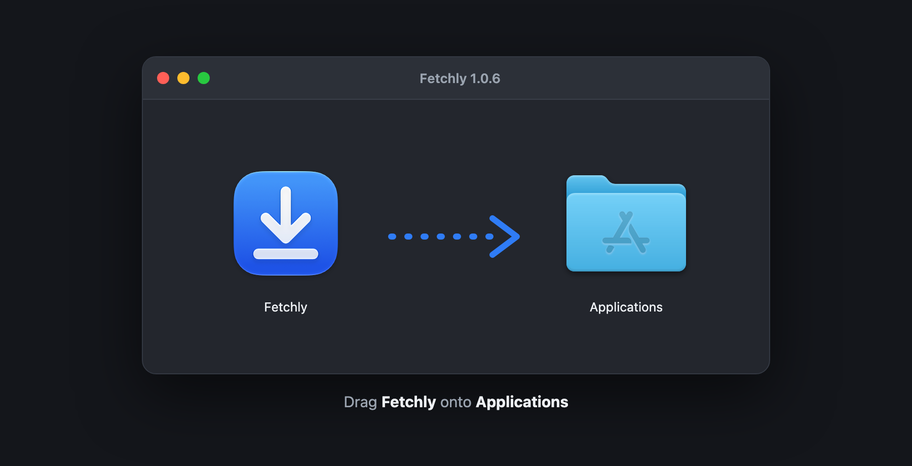
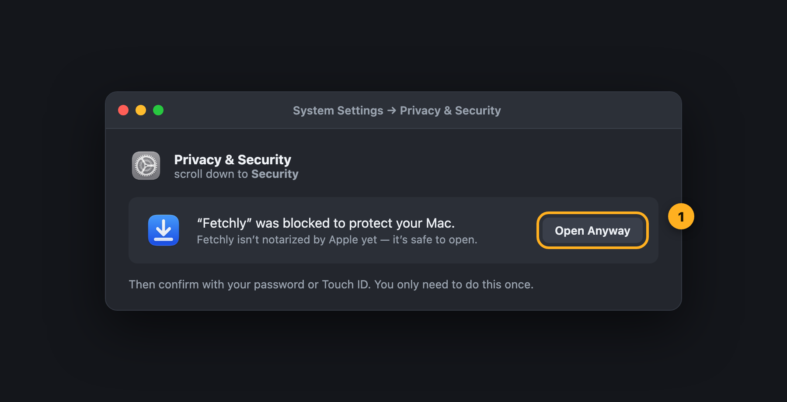
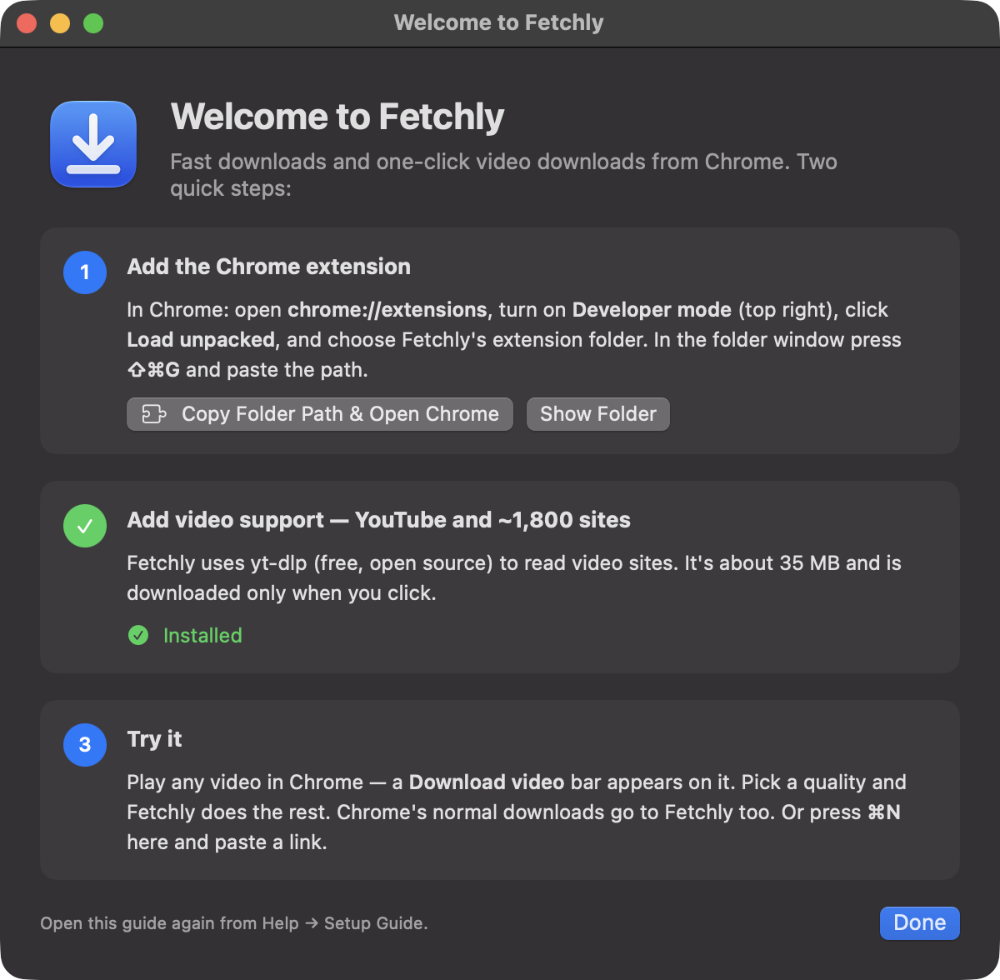
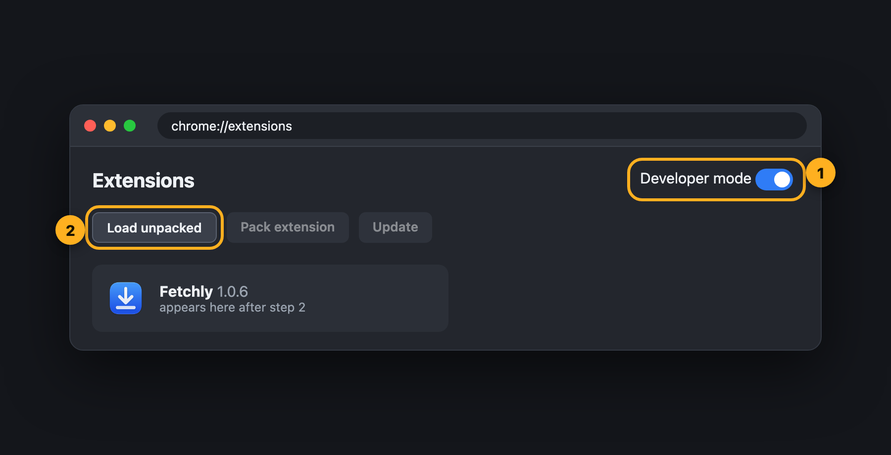
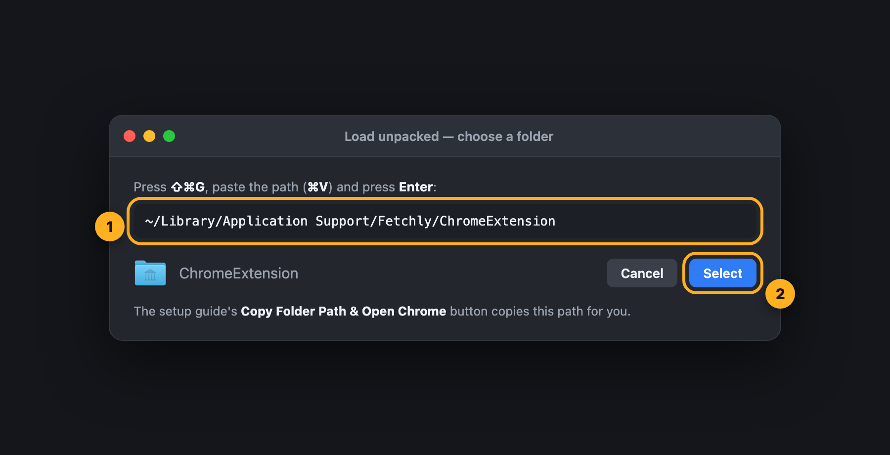
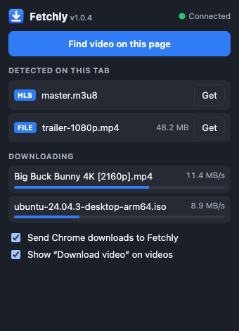
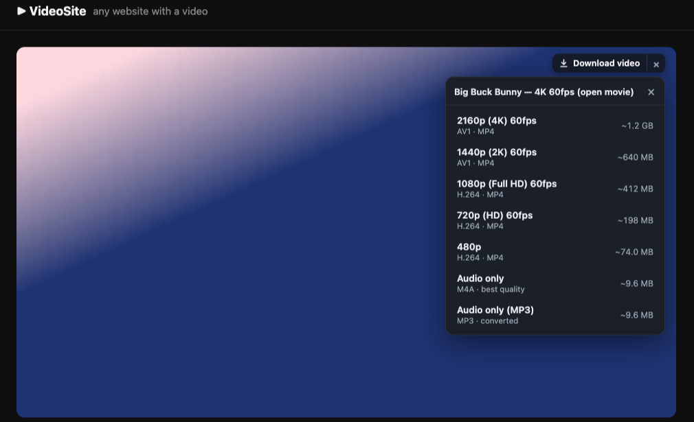

# Installing Fetchly

Setup takes about 3 minutes. You need a Mac with **macOS 14 (Sonoma) or later** (Apple Silicon or Intel) and **Google Chrome** (or Edge, Brave, Arc or Opera).

- [1 · Install the app](#1--install-the-app)
- [2 · Open it the first time](#2--open-it-the-first-time)
- [3 · Add the Chrome extension](#3--add-the-chrome-extension)
- [4 · Add video support](#4--add-video-support)
- [5 · Check it works](#5--check-it-works)
- [Updating](#updating) · [Uninstalling](#uninstalling) · [Troubleshooting](#troubleshooting)

---

## 1 · Install the app

1. Download **[Fetchly.dmg](https://github.com/muksiturrahman/fetchly/releases/latest/download/Fetchly.dmg)** (about 2 MB) and open it.
2. Drag **Fetchly** onto **Applications**.



> Prefer a zip? [Fetchly.zip](https://github.com/muksiturrahman/fetchly/releases/latest/download/Fetchly.zip) has the same app. Unzip it and move `Fetchly.app` to Applications.

## 2 · Open it the first time

Fetchly isn't notarized by Apple yet, so macOS asks you to confirm the first launch:

1. Double-click Fetchly in Applications. macOS says it can't verify the app. Click **Done**.
2. Open **System Settings → Privacy & Security**, scroll down to **Security**, and click **Open Anyway** next to Fetchly. Confirm with your password or Touch ID.



You only do this once. If you prefer Terminal, this single command does the same:

```bash
xattr -dr com.apple.quarantine /Applications/Fetchly.app
```

Fetchly then opens its **setup guide**, which has buttons for the next two steps:



## 3 · Add the Chrome extension

The extension spots videos on web pages and hands Chrome's downloads to the app. Google doesn't allow YouTube downloaders in the Chrome Web Store, so it's added in developer mode:

1. In the setup guide, click **Copy Folder Path & Open Chrome**. This copies the extension's folder path and opens `chrome://extensions`.
2. Turn on **Developer mode** (top right) **①**, then click **Load unpacked** **②**.

   

3. In the folder window press **⇧⌘G**, paste the path with **⌘V** and press **Enter** **①**, then click **Select** **②**.

   

   The path is `~/Library/Application Support/Fetchly/ChromeExtension`. Fetchly keeps the extension there and updates it with the app.

4. Click the puzzle-piece icon in Chrome's toolbar and **pin** Fetchly.

## 4 · Add video support

YouTube and about 1,800 other sites need **yt-dlp**, a free open-source tool. In the setup guide (or **Settings → Video**), click **Download yt-dlp**. It's about 35 MB, downloaded only when you click.

For **1080p and above (including 4K)**, YouTube sends the video and the sound as separate streams, and **ffmpeg** joins them. Install it with [Homebrew](https://brew.sh):

```bash
brew install ffmpeg
```

Without ffmpeg, Fetchly simply offers the qualities that already include sound (usually up to 720p).

YouTube also needs a JavaScript runtime (**Node.js**, **Deno** or **Bun**). If you have any of them, Fetchly finds it by itself.

## 5 · Check it works

- The **Fetchly popup** in Chrome says **Connected** and shows the version:

  

- Open any video and press play. A **Download video** bar appears on it. Click it and pick a quality:

  

- In the setup guide, all the steps show a ✓.

---

## Updating

Download the new **Fetchly.dmg** and drag it onto Applications again (replace the old one). Then:

1. Open `chrome://extensions` and click **↻** on the Fetchly card.
2. Refresh your open tabs.

The card, the popup and the app's status bar all show the version, and the popup warns you if the extension and the app don't match.

## Uninstalling

1. Remove the extension in `chrome://extensions`.
2. Quit Fetchly and move it from Applications to the Trash.
3. Optional: delete `~/Library/Application Support/Fetchly` (the download list, the extension copy and yt-dlp). Your downloaded files are not touched.

## Troubleshooting

| Problem | Fix |
| --- | --- |
| The popup says **Not running** | Open the Fetchly app. It has to be running, in the Dock or the menu bar. |
| The popup says the extension is **older than the app** | Click **↻** on Fetchly in `chrome://extensions`, then refresh the page. |
| Chrome says **"Developer mode" is managed by your organization** | Your work profile blocks it. Use a personal Chrome profile. |
| No **Download video** bar | Refresh the page after installing. Check that **Show "Download video" on videos** is on in the popup. Small, muted or looping clips (backgrounds, previews) are ignored on purpose; hover over them to show the bar. |
| "Video support isn't installed" | Settings → Video → **Download yt-dlp**. |
| YouTube fails after it worked before | Sites change often. Use Settings → Video → **Check for Update** to update yt-dlp. |
| 4K file won't play in QuickTime | It's AV1 or VP9. Use [IINA](https://iina.io) or VLC, or choose **MKV** in Settings → Video. |
| Port 6801 in use | Another copy of Fetchly is open. Quit it. |
