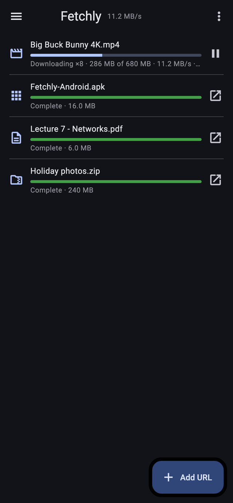

# Install Fetchly on Android

**Other systems:** [Mac](mac.md) · [Windows](windows.md) · [Linux](linux.md) · [Download page](https://muksiturrahman.github.io/fetchly/)

You need **Android 7 or later**. It takes a minute.

## 1 · Install

1. On the phone, open **[Fetchly-Android.apk](https://github.com/muksiturrahman/fetchly/releases/latest/download/Fetchly-Android.apk)** (about 17 MB). It works on almost every phone (64-bit).
   Very old 32-bit phones need **[Fetchly-Android-armv7.apk](https://github.com/muksiturrahman/fetchly/releases/latest/download/Fetchly-Android-armv7.apk)** instead.
2. When the download finishes, tap it. Android asks to **allow installing apps from this source** (your browser): allow it, go back, and tap **Install**.
3. If **Play Protect** warns about an unknown app, tap **More details → Install anyway**. Fetchly isn't in the Play Store, so Google doesn't know it yet.

## 2 · Download something

- Open Fetchly and tap **Add URL**, paste a link (or tap the paste icon), and tap **Download**.
- Or, in any app (Chrome, a chat, a file-sharing site), tap **Share → Fetchly**: the link opens in Fetchly ready to download.

Files are saved in **Download/Fetchly**, which the **Files** app shows. Tap a finished download, or its ↗ button, to open it.

## What works on Android

| | |
| --- | --- |
| Any file link (zip, pdf, apk, mp4 …), several connections at once, pause and resume | ✓ |
| Video streams (`.m3u8`) that aren't encrypted | ✓ saved as one file |
| Pages that show a video file (the page is scanned for it) | ✓ |
| YouTube, up to 4K with sound | ✓ Pick a quality; 720p and up come as video + sound, which your phone joins after downloading (1440p and 4K as WebM, Android 10 and later) |
| Other video sites | ✓ The videos on the page, listed by quality and size (previews left out). For sites that hide their videos, use Fetchly on your [Mac](mac.md), [Windows](windows.md) or [Linux](linux.md) |
| The Chrome extension | ✗ Chrome for Android has no extensions. Use **Share → Fetchly** instead. |

Downloads keep going when you switch apps, lock the screen or swipe Fetchly away: a **Downloading…** notification shows the progress while they run, and goes away when they're done. Allow Fetchly's notifications when Android asks (or later in Settings), so you can see it.

## Updating

Open the new APK and tap **Update**. Your download list and settings are kept.

## Uninstalling

Uninstall Fetchly like any app. Files in **Download/Fetchly** stay.
